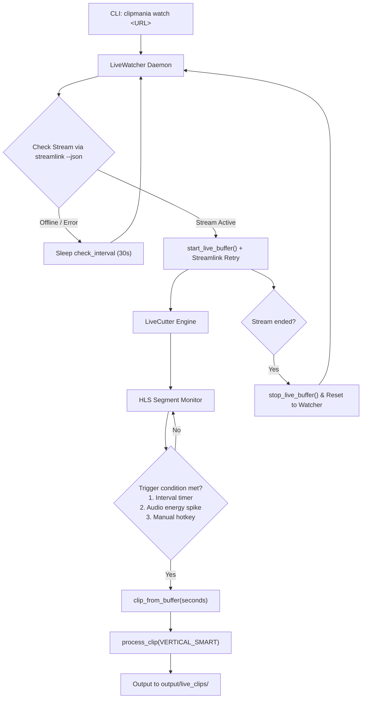

# Design Specification: Live Stream Channel Watcher & Live Clipping Engine

**Date:** 2026-11-17  
**Status:** Draft for Review  
**Target Module:** ClipMania v0.3.0  
**Authors:** Damon Cook / Antigravity

---

## 1. Intent & Problem Statement

ClipMania currently requires manual intervention to clip live broadcasts: a user must know a creator is streaming, manually run `clipmania live-start <URL>`, wait, and then execute `clipmania clip-now --seconds <N>`.

### The Goal:
Allow a user to register any creator channel URL on **YouTube, Twitch, Kick, or Rumble**. A background watcher monitors the channel status. When the creator goes live, ClipMania automatically starts buffering the live stream, continuously detects/extracts highlight clips in real time, processes them into vertical short-form videos (`vertical-smart` layout with OpenCV facecam framing), and saves them ready for posting.

---

## 2. Requirements & Scope

### Goals (In Scope):
1. **Multi-Platform Live Detection (YouTube, Twitch, Kick, Rumble):**
   - Add native `RUMBLE` platform support to `Platform` enum, regex detectors, channel extractors, and platform specs.
   - Channel live detection via `streamlink --json <url>` without requiring platform API credentials.
2. **Hybrid Monitor Architecture (Approach 2 + 1):**
   - **Phase A (Offline Monitoring):** Periodic poll loop (`--json`) checking channel status every $N$ seconds (default: 30s) with negligible CPU/network impact.
   - **Phase B (Live Transition):** Once live, launch the rolling HLS buffer (`streamlink_live.py`) with Streamlink stream-retry flags (`--retry-streams 5 --retry-max 5`) to withstand transient connection drops.
   - **Phase C (Stream Termination):** Detect when the broadcaster goes offline, gracefully flush any remaining clip candidate, stop buffer processes, and return to Phase A.
3. **Automated Live Clipper (First Workflow):**
   - Continuous segment analysis during the live broadcast:
     - **Configurable interval clipping:** Automatically cut clips every $N$ minutes (e.g. every 5 or 10 minutes) capturing the preceding 30–60s window.
     - **Audio energy spike detection:** Monitor the audio track of new HLS segments; when audio loudness exceeds dynamic threshold (e.g., loud reaction/cheering), trigger an immediate clip extraction.
   - Extracted clips pass through the existing `process_clip` pipeline:
     - Smart layout framing (`Layout.VERTICAL_SMART` with facecam cluster detection).
     - EBU R128 audio normalization.
     - Platform spec validation (`TikTok`, `YouTube Shorts`, `X`).
4. **CLI User Experience:**
   - New CLI command: `clipmania watch <URL>`:
     - `--check-interval` (default 30s)
     - `--clip-interval` (default 5m)
     - `--window` (default 60s)
     - `--layout` (default `vertical-smart`)
     - `--platform` (default `tiktok`)
     - `--energy-trigger / --no-energy-trigger` (enable audio spike detection)

### Non-Goals (Out of Scope for First Workflow):
- Automated social media OAuth posting (TikTok API / YouTube API / X API upload) — this will be handled in a follow-up workflow once the live clipping engine is tested and landed.

---

## 3. Architecture & Data Flow

---

## 4. Component Breakdown

### 4.1. Platform Expansion (`clipmania/utils.py` & `clipmania/platforms.py`)
- Add `Platform.RUMBLE = "rumble"` to `Platform` enum.
- Add `rumble.com` domain mapping in `_PLATFORM_DOMAINS`.
- Enhance `extract_channel()` for Rumble URLs (e.g. `https://rumble.com/c/ChannelName` or `https://rumble.com/user/UserName`).
- Add `"rumble"` spec to `PLATFORM_SPECS`.

### 4.2. Stream Prober (`clipmania/ingestion/stream_probe.py`)
- `probe_stream_status(url: str, timeout: int = 15) -> StreamStatus`:
  - Executes `streamlink --json <url>` with timeout.
  - Returns structured `StreamStatus(is_live: bool, title: str, author: str, quality_available: list[str])`.
  - Handles offline streams and plugin errors without raising tracebacks.

### 4.3. Channel Watcher Daemon (`clipmania/ingestion/live_watcher.py`)
- `LiveWatcher`:
  - Manages watcher state (`OFFLINE`, `MONITORING`, `LIVE`, `COOLDOWN`).
  - Implements the polling loop with backoff and graceful Ctrl+C cancellation.
  - On stream start, triggers buffer spawn with Streamlink HLS resilience.
  - Periodically checks stream health during live playback.

### 4.4. Live Event / Highlight Trigger (`clipmania/processing/live_cutter.py`)
- `LiveCutter`:
  - Attaches to the active live buffer directory.
  - Inspects newly added `.ts` segments.
  - Tracks running RMS / peak audio volume across segments.
  - Cuts clips either:
    1. Periodically on timer (e.g., every 5 minutes).
    2. Dynamically when RMS audio loudness exceeds standard deviation threshold (cheer/shout peak).
  - Feeds raw clip into `process_clip()`.

### 4.5. CLI Command (`clipmania/cli.py`)
- `clipmania watch <URL>` command wired with Rich live status dashboard displaying:
  - Current channel state (Offline / Polling / Buffering / Clipping).
  - Last clip timestamp and thumbnail/output path.

---

## 5. Verification Plan

1. **Unit Tests:**
   - `test_rumble_detection`: Verify Rumble URL parsing and channel extraction.
   - `test_stream_probe`: Mock `streamlink --json` output for both live and offline states.
   - `test_live_watcher_lifecycle`: Test state transitions (`OFFLINE` -> `LIVE` -> `ENDED`).
   - `test_live_cutter_interval`: Verify periodic clipping schedule and buffer extraction.
   - `test_live_cutter_audio_spike`: Verify energy spike detection triggers clipping.
2. **Integration Verification:**
   - Test CLI `watch` subcommand parsing with Click runner.
   - Verify graceful cleanup of detached processes on interruption.
